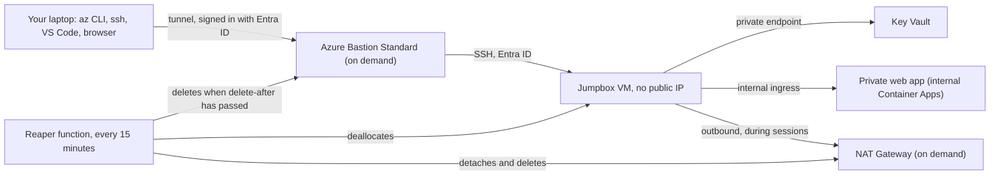

<div align="center">

# Private Azure resources from your laptop, with Bastion on demand

**Reach private endpoints, private web apps and private clusters in an Azure virtual network from your own terminal, editor and browser, through an Azure Bastion that exists only while you use it and deletes itself when its time is up.**

[](LICENSE)
[](infra)
[](azure.yaml)
[](docs/DECISIONS.md)

[**Why**](#why-this-sample) · [**How it works**](#how-it-works) · [**Daily use**](#daily-use) · [**Cost**](#cost) · [**Documentation**](#documentation)

</div>

> **Status:** in progress (November 2026). The design is settled ([decisions](docs/DECISIONS.md)); phases 1 to 3 (the base, sessions on demand from the laptop, and the reaper) are deployed and checked; measured costs come next ([verification](docs/verification.md)).


## Why this sample

Locking resources behind private endpoints is the easy part; working with them afterwards is not. Your laptop can't resolve `privatelink` names or reach private IP addresses, so `kubectl`, `azd deploy`, a database client or a browser stop working. A VPN gateway or an always-on Bastion solves it, at more than 100 € a month whether you use it or not. This sample keeps the access path cheap by creating it only when you need it, and makes sure it doesn't stay forgotten.

## What it shows

- **Azure Bastion Standard on demand:** created by a script for a working session, tagged with the time it must be deleted (`delete-after`), extended by a script if you need longer.
- **Your own tools:** SSH with your Entra identity (no SSH key), tunnels, VS Code Remote-SSH to a jumpbox, and SSH forwarding to reach private services from the laptop.
- **A reaper:** an Azure Function (Flex Consumption, .NET isolated) that checks every 15 minutes and deletes any Bastion host past its time, or without a time, then deallocates the jumpbox and removes the session's NAT Gateway.
- **Private targets to try it on:** Key Vault behind a private endpoint, and a web app in an internal Container Apps environment.
- **Least privilege:** the reaper's managed identity can delete Bastion hosts and NAT Gateways, detach a NAT Gateway from the jumpbox subnet, deallocate the jumpbox, and nothing else ([D10](docs/DECISIONS.md)).

## How it works



- **Permanent** (Terraform): the virtual network with its subnets, the Bastion's public IP, the jumpbox (deallocated between sessions), the private targets and the reaper.
- **Per session** (scripts): the Bastion host and the NAT Gateway, created together and deleted together ([D2](docs/DECISIONS.md), [D6](docs/DECISIONS.md)).

## Daily use


```bash
make bastion-up                 # creates the Bastion host and the NAT Gateway, starts the jumpbox; deleted 8 hours later
make bastion-extend HOURS=2     # moves the delete-after time
make bastion-ssh                # SSH to the jumpbox with your Entra identity
make bastion-down               # deletes both now and deallocates the jumpbox
```

To reach private services, open the tunnel (`make bastion-tunnel`), then forward through the jumpbox: `ssh -F .ssh/config -N -D 1080 jumpbox` gives a SOCKS proxy on `127.0.0.1:1080` for a browser, `curl --socks5-hostname`, the Azure CLI (`HTTPS_PROXY=socks5h://127.0.0.1:1080`) or `kubectl` (`proxy-url` in the kubeconfig). Private names are resolved on the jumpbox ([verification](docs/verification.md) V5, V6).

From Windows with the scripts in WSL: the tunnel's and the proxy's ports reach Windows, so a browser can use the proxy (for example Edge with its own profile and `--proxy-server=socks5://127.0.0.1:1080`). For VS Code Remote-SSH from Windows, use Windows' own OpenSSH with a copy of `.ssh/id_entra` and its certificate (valid about an hour), not WSL's `ssh`.

The reaper runs every 15 minutes in any case; `make test` runs its unit tests and the Terraform module tests.

## Cost

Retail prices, francecentral, November 2026, before measurement ([phase 4](docs/verification.md)):

| Part | When it costs | Price |
|---|---|---|
| Azure Bastion Standard | only while a session's host exists | 0.2603 € an hour |
| NAT Gateway | only during sessions | 0.0404 € an hour, plus 0.0404 € per GB |
| Jumpbox (D2als v7, [D7](docs/DECISIONS.md)) | while running; its disk always | 0.0847 € an hour |
| Private endpoint (Key Vault) | always | 0.009 € an hour |
| Bastion public IP | always | 0.0045 € an hour |

For comparison, the same Bastion always on costs about 190 € a month ([D2](docs/DECISIONS.md)).

## Documentation

| Document | Content |
|---|---|
| [Decisions](docs/DECISIONS.md) | Each design choice and why |
| [Verification](docs/verification.md) | What was checked, how and when |
| [AGENTS.md](AGENTS.md) | How the sample is built, for people and coding agents |

## Clean up

`azd down --purge` deletes the resource group, including any Bastion host and NAT Gateway left.

## License

[MIT](LICENSE)
